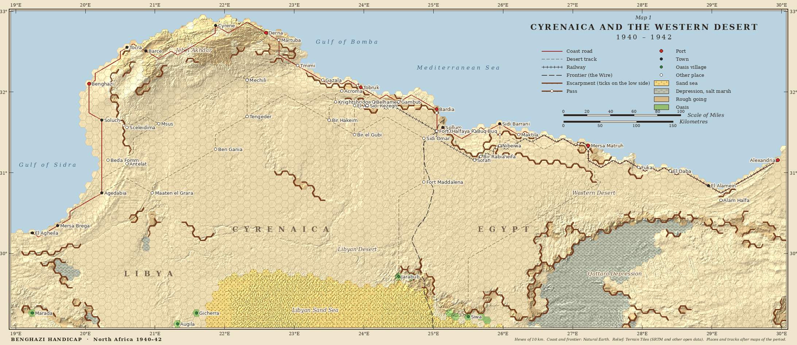

# Benghazi Handicap: North Africa 1940–42

An original operational wargame of the North African campaign, 1940–1942:
small and neat like the 8-bit desert wargames, but with the real ground, the
real tempo of a desert battle and, above all, the real supply problem.

- **`DESIGN.md`** — the game: scale, map, units, sequence of play, supply,
  combat, orders, scenarios, the computer opponent, presentation.
- **`docs/RULES.md`** — the rules specification the engine follows, numbered, with
  every constant named and its source given.
- **`docs/COUNTERS.md`** — hex and counter sizes, and notes on counter art.
- **`docs/SOURCES.md`** — where the map, the orders of battle and every date come from.
- **`docs/MAP.md`** — how the map is generated, and its known limitations.
- **`docs/CLEAN_ROOM.md`** — what this project may and may not use.
- **`PLAN.md`** — the owner's decisions by date, and the plan for later.
- **`docs/TODO.md`** — everything known to be open.
- **`docs/BOM.md`** — every picture, effect and sound, and what is still wanted.
- **`docs/HANDOFF.md`** — a brief for a reviewer new to the project.
- **`docs/ENGINEERING_NOTES.md`** — how the engine is built and tested.

Status: the **map generator**, the **rules specification**, the **engine
core** on Operation Crusader and on a short scenario cut from it, and the
**pygame screen**, played by two people at one screen or against a deterministic
computer opponent. The opponent is a first playable version; its decisions and
the scenario balance still need playtesting.

## The engine

`engine/` is pure Python with no input or output but the reading of a scenario
file: the same scenario and the
same orders always give the same game. A turn is the eight phases of
`docs/RULES.md` §5; each function names the rule it follows and each test the
rule it checks.

```
.venv/bin/python -m engine crusader attack nothing   # a whole game, no screen
```

plays Operation Crusader (`data/scenarios/crusader.json`: 91 units, each
division shown as its regiments and brigades under its HQ) between two scripted
players (`nothing`, `attack`, `retreat`, `explore`, or `computer`) and asserts the rules'
invariants after every turn.

`sidi_rezegh` in place of `crusader` plays the short scenario: Crusader's first
five turns, 18 to 27 November 1941, with one aim, the road into Tobruk. Its file
(`data/scenarios/sidi_rezegh.json`) names Crusader as its base and gives only
what differs (`docs/RULES.md` 2.4), so the two cannot drift apart.

## The screen

`screen/` is a pygame window on top of the engine: the map, the counters, the
six orders, the supply overlay and the zones overlay.

```
.venv/bin/python -m screen crusader                  # two players at one screen
.venv/bin/python -m screen sidi_rezegh --axis computer # you command Commonwealth, computer commands Axis
.venv/bin/python -m screen sidi_rezegh --cw computer   # you command Axis, computer commands Commonwealth
.venv/bin/python -m screen crusader --axis computer    # full scenario against the computer
.venv/bin/python -m screen sidi_rezegh --axis computer --cw computer # watch both computer commanders
.venv/bin/python -m screen sidi_rezegh --axis computer-easy --cw computer-hard --seed 1941 # compare levels
.venv/bin/python -m screen crusader --shot frame.png # one frame to a file, no window
.venv/bin/python -m screen crusader --log            # record every click and key, in logs/ (not published)
.venv/bin/python -m screen crusader --seed 1941      # the same weather as an earlier game; --seed 0 for none
.venv/bin/python -m screen --load                    # go on with the game saved last
.venv/bin/python -m screen --load saves/FILE.json    # go on with that one
```

An interactive launch opens on a title card over the map. Click **Continue
to map** or press Enter/Space to begin; the window's X closes the game.
The same hex emblem appears on the title and in the window icon.
In computer versus computer mode, turns run automatically and each turn's
replay is shown from the Axis view. Space or the footer button pauses or
resumes a replay; F changes its speed, and the scene arrows step backward
or forward. The final result stays on screen. For a match without a window,
run `.venv/bin/python -m engine sidi_rezegh computer computer --seed 1941`.

Each side can independently use `computer-easy`, `computer` (standard), or
`computer-hard`. Easy plans around nearby ground and builds only basic
fieldworks; standard weighs the objective values; hard gives the Sidi Rezegh
corridor more weight, concentrates formations on key ground, protects held
objectives when threatened, digs deeper, and can send a mobile formation with
a command HQ on a desert raid in the longer campaign.
All three use the same limited view and the same combat and luck rules.
The selected levels appear on the opening card and persist in saved games.
To compare them without a window, run
`.venv/bin/python -m engine sidi_rezegh computer-easy computer-hard --seed 1941`.
For all nine level pairings on the same weather seeds, run
`.venv/bin/python scripts/compare_computers.py --seeds 0 1 65 1941 2026`.
For paired comparisons of a proposed Hard policy against the current one,
use `scripts/benchmark_ai.py`; its metrics and early findings are in
[docs/COMPUTER_BENCHMARK.md](docs/COMPUTER_BENCHMARK.md).

Press **F12** at any point in the game (or choose **Game → Screenshot**)
to save a PNG of the current map and GUI (including open panels) in
`screenshots/`. Each press makes a new file; captures are excluded from Git.
On this PC, find them in Windows Explorer at
`D:\dev\PROJECTS\benghazi-handicap\screenshots\`. Share a capture here
for GUI review.

A game can be saved and taken up again. The Game button in the map's corner has
Save game (F5) and Load game (F9), which lists the newest saves to tap. The game
is also saved by itself each time orders are handed in and when the window is
closed, so `--load` goes on from where it was left, with the orders given so far.
A save is one file of plain text under `saves/` (not published): the scenario, the
state, the orders of the turns played and the orders that stand. A game taken up
from it goes on exactly as it would have. A save from a version whose rules or
scenario no longer fit is refused, not guessed at.

Click one of your units, press Move or Attack, then click where it should go.
With no order a unit holds, and Hold is the button lit; a click on the map gives
no order until Move, Attack or March has been pressed, so a unit on its way keeps
its route whatever is clicked. The full-width command footer keeps the selected unit's flag and name,
its available orders, Next unit and End turn in view even when details are hidden. Unavailable orders
stay in their positions but are greyed out. With the keyboard alone:
press M, A or R, choose the hex with the arrow keys and press Enter. Keys 1, 2
and 3 give the air force's effort (support, interdict, recon); the **Air** selector
at the right end of the message line shows the current choice and opens a clickable
menu explaining each choice and this turn's air points (or grounded aircraft).
F3 switches between pictures and NATO-style counter symbols. The mouse
wheel zooms at the pointer, dragging moves the map, and with a unit taken up
the map scrolls when the pointer reaches its edge. Layers, in the map's
corner, offers a terrain key, weather chip, supply and zones overlays, and the
Pictures/NATO preference. The chevron at the right of the map hides or restores
the details panel, giving the map its space. Men on foot March where vehicles
Travel: by road or track only, a little faster than across country. The footer shows the orders;
pressing its own lit order takes it back. With nothing taken up the panel
lists the units still waiting, and a tap goes to one. After an order the next unit waiting is taken up and brought to the middle. A click on
any of your units takes it up, whatever is in hand and whether it has an order or not. To
move a unit on to others of yours, press Move first, or use Join. A right click on your own units opens a menu to choose
one, group the whole stack or split a group up, at once; a stack of units from more
than one division is a Special Army Group, and the pencil by a group's name renames it. A division's units move and fight as one group until you split one off: the panel shows a group as its order of
battle, its HQ's card above connected illustrated rows for its units; click a row and order it, or press Split. Join sends a unit back to its
division, and Recall, on an HQ, calls them all in. An order with somewhere to go (Move, Attack, Travel, Join)
stands from turn to turn until it is done, and Dig in until the defences are complete; Rest is
for one turn, and a unit with no order holds. Every turn the screen steps through every unit
or group: Space lets it carry on as it is, and any order changes it. With the pointer on the unit's tile in the panel, the mouse wheel or Up and Down go through
everything of yours in its hex: each group, then each of its units by itself. Page Up and Page Down do so
wherever the pointer is, and the arrows beside "3 of 6" in the details by a tap. Every order's button
unpresses: pressing a unit's lit button takes its order back, and it holds unless given another. An order a unit cannot take just now is greyed, with the reason under the
unit. A hex holds the units of two formations; a unit
may drive through a full hex but not stop in it, and one kept out says so. Every click on the map does something or says why not. Two things are left to
chance. Each battle has its luck, up to a tenth on the attack either way and most often little; and some turns
bring rain or a sandstorm, told as the turn opens with an outlook for
the next that is often wrong. An attack counts for more with an army or corps HQ behind it, in reach, in supply and
not moved this turn. Of the enemy you see no figures: a unit beside yours is at strength, worn or weak, and after a
battle the reports give what you claim to have knocked out, which is more than he lost for good. It shows as a wash over the map and a chip in its corner; a tap on
the chip says what it does. The screen prints the game's weather seed when it starts. The panel's Unit orders tab lists
every unit and its order, to scroll through; a tap takes one up. Its Timetable tab lists what is called
away, what arrives or is made good, and anything else, each kind under its own heading (Withdrawals,
Reinforcements, Other), on the day it happened in 1941 and with the reason. A red bubble on the tab counts
the events that fall as this turn ends, to plan for now; the reports say so a turn
before each falls due and again when it has happened (`docs/SOURCES.md` gives the source of every date). Next unit is lit while any
unit waits, End turn is always there, and a tick box turns off the reminder of units not gone through. In a short
window, the panel scrolls with the mouse wheel or the arrows on its right edge; the command footer stays in place. After End
turn the turn is played back: the movement, then each formation's strike in
turn, with the units it hits burning and a rattle as long as the damage, then
the outcome, where a unit that surrenders raises a white flag. The map shows
small **Back**, **Next**, **Speed** and **Done** controls in the footer throughout playback; F
toggles speed, Left arrow or B rewinds, Right arrow or N advances one scene, and any other key skips
the rest. Clicking elsewhere leaves the playback running. A finished game shows how its result was reached. The
map is `art/basemap.jpg`, the generated map with its relief
(`python -m mapgen base`). The pictures on the counters are AI-generated for this game, in
`art/counters/artist/` (cut by `python -m countergen cut`), with the game's own
drawn set in `art/counters/` (`python -m countergen`) for those not done yet.
`docs/COUNTERS.md` has the hex and counter sizes and the notes on counter art;
`docs/BOM.md` lists what is still wanted.

## The map



The map is not drawn by hand: `mapgen/` builds it from public geographic data.

```
python3 -m venv .venv && .venv/bin/pip install -r requirements.txt
.venv/bin/python -m mapgen all      # fetch the data, build data/map.json, draw map.png
.venv/bin/python -m pytest tests
```

- **123 × 44 hexes of 10 km**, from west of El Agheila to Alexandria and from the
  Cyrenaican coast south to Siwa.
- **Terrain per hex**: sea, desert, rough going, deep depression (the Qattara
  Depression), sand sea, oasis — from the coastline, from elevation and slope,
  and (the sand sea and the oases) from maps of the period.
- **Escarpments on hex edges**: the cliff lines are traced in the elevation data
  and laid on the hex edges they run between, so an unbroken cliff is an
  unbroken line on the map; hills ringed by escarpments become rough ground.
- **Places and routes** from `data/features.json` (53 places; the coast road,
  desert tracks and the railway): each route finds its own way over the
  generated ground between the places it names, and where it has to climb an
  escarpment, that crossing becomes a **pass**.
- **Drawn by hand where it matters most**: the Sollum escarpment, from the sea
  at Sollum south-east to Sofafi, with its two ways up — **Sollum Pass** (the
  coast road) and **Halfaya Pass** (a track) — and the two gentler escarpments
  that carry on east from Sofafi, behind Sidi Barrani and along the plateau
  edge to south of Matruh.
- **The picture**, `map.png`, is drawn in the manner of a map of the period:
  relief shading, a border with the degrees marked, a title block with legend
  and scale.
- The result, `data/map.json`, is readable: one row of terrain letters per map row.

Known limitations of this first version (see `docs/MAP.md`):

- the escarpments are checked against the elevation data, not against period
  maps, and only Sollum has named passes; elsewhere a pass is simply where a
  route climbs;
- 26 of the 53 places have approximate coordinates; places and tracks have
  been checked against two period maps (Gazala 1942 and Cyrenaica 1941, see
  `docs/MAP.md`), but the tracks are still joined from place to place, not traced;
- the sand sea's edge is read off a small-scale period map; the coastal salt
  marshes are not marked.

## The name

**The Benghazi Handicap** was the soldiers' name — the Australians', first — for
the retreat from Benghazi to Tobruk in the spring of 1941, with Rommel close
behind. The race was run again, in both directions: Benghazi changed hands five
times in under two years, as each advance along the coast road ran out of supply
and was thrown back. The retreat from the Gazala line in June 1942 earned its
own name, the *Gazala Gallop*.

> **Etymology.** Named for the great speed of the retreat; *handicap* is in the
> horse-racing sense. The field was large, the going was firm to dusty, and the
> favourite changed at every meeting.

Why this name:

- **It says what the game is about.** The campaign was decided by distance and
  supply — how far an army could go before its trucks could no longer feed it —
  and that is the centre of this design (`DESIGN.md` §6).
- **It is historical and nobody's product.** It is a period nickname (it is the
  title of a chapter in the Australian official history), not a trademark. A few tabletop wargame supplements have used it as a subtitle; no
  computer game uses it as its title.
- **It stands apart from other games.** Plainer names were considered and
  dropped because they sit too close to existing titles: "Desert War" (Matrix
  Games' *Desert War 1940–1942*, and a scenario title in older games) and
  "Desert Rats" (CCS, 1985, the 8-bit game that inspired this one).
- **The subtitle says the rest.** "North Africa 1940–42" tells a newcomer the
  subject at a glance.

This is an original game. It shares a subject — a public piece of history —
with many other wargames, and nothing else: its map is generated from public
geographic data, its orders of battle are compiled from historical sources, and
its rules, text and art are its own (`docs/CLEAN_ROOM.md`).
