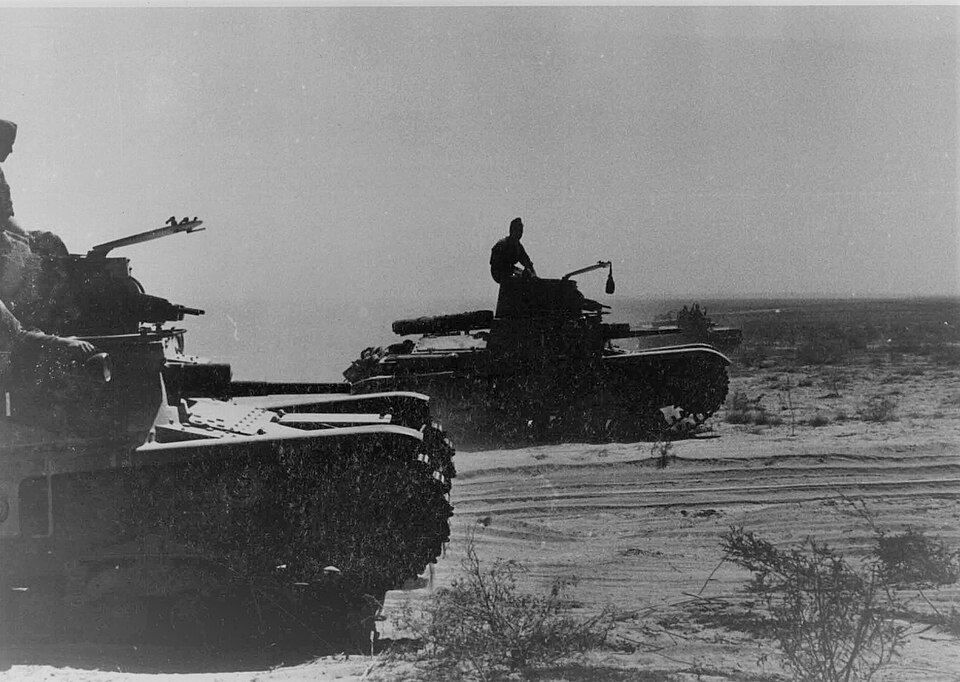
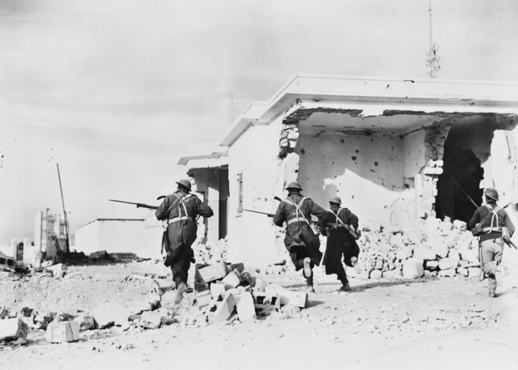
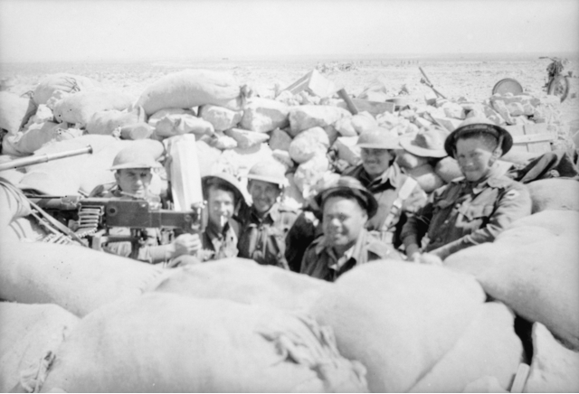
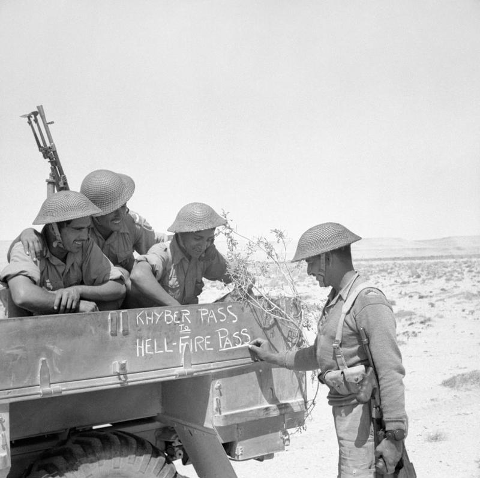
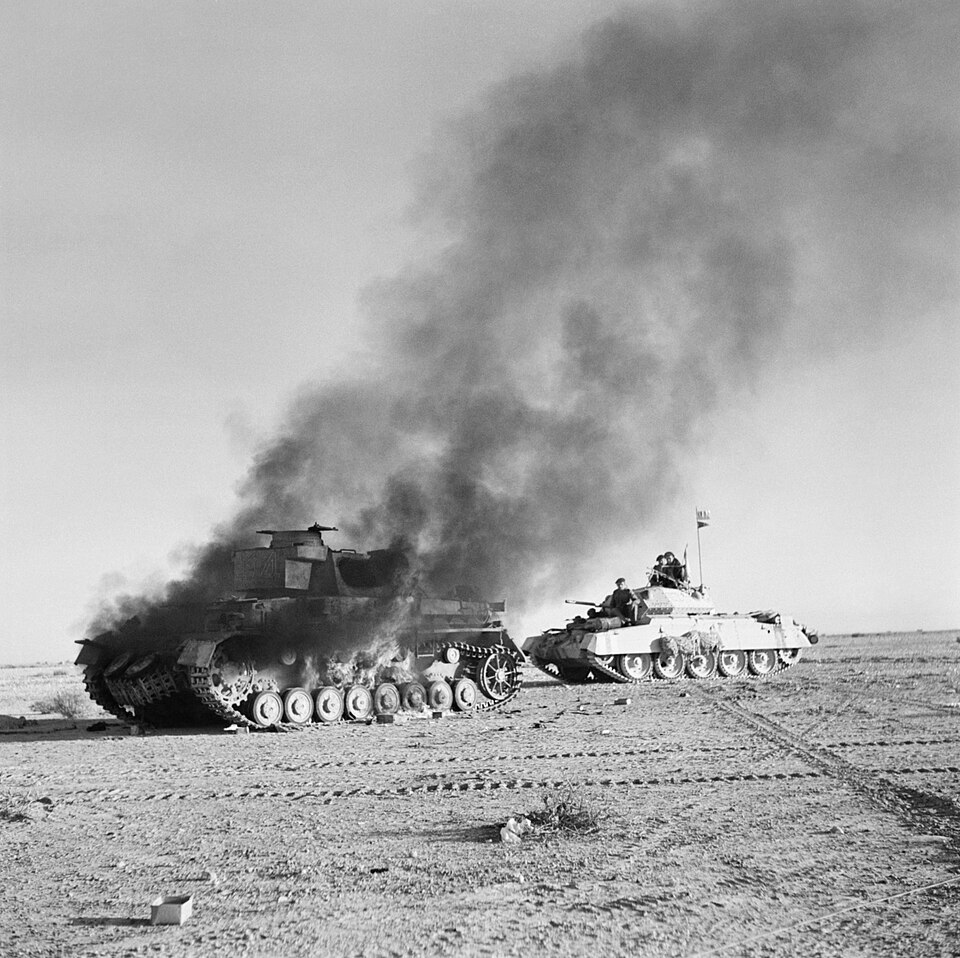
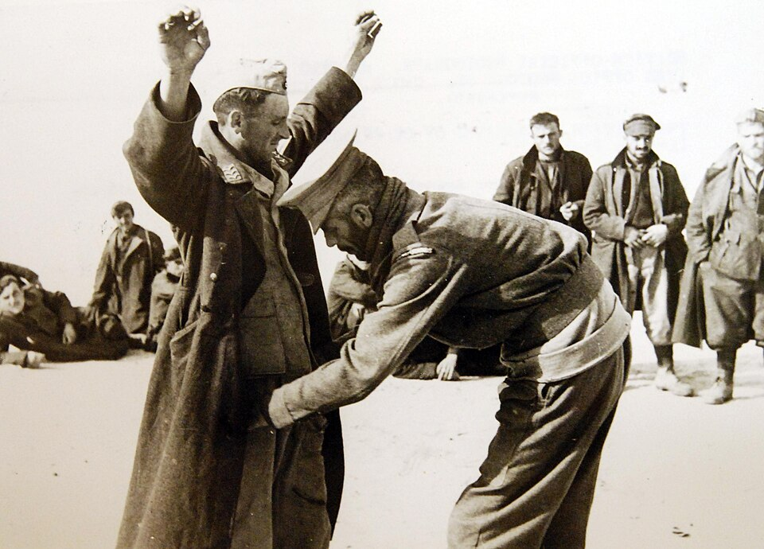
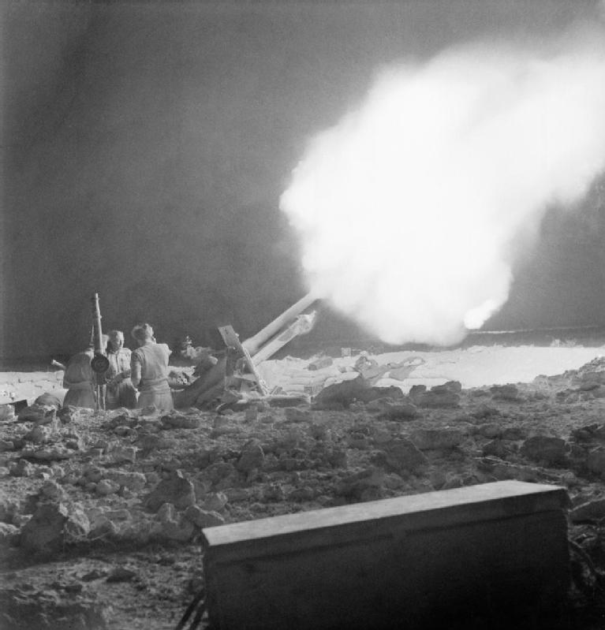
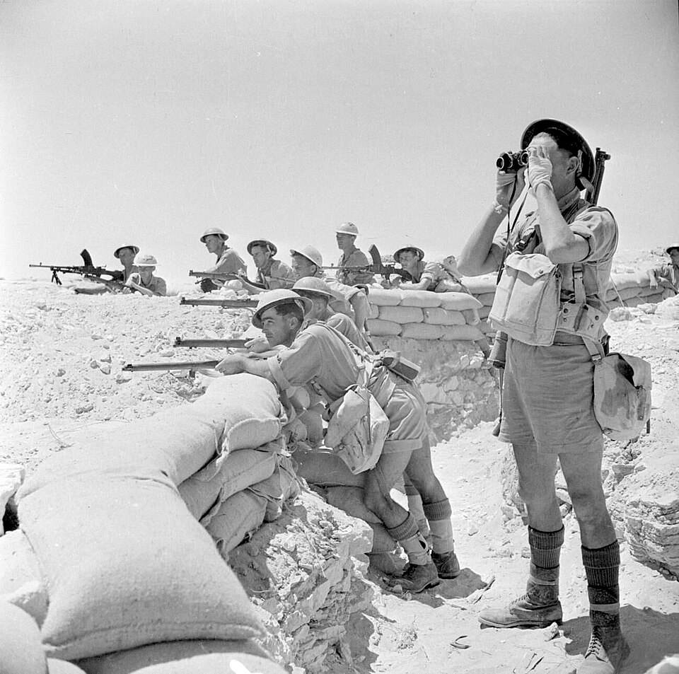
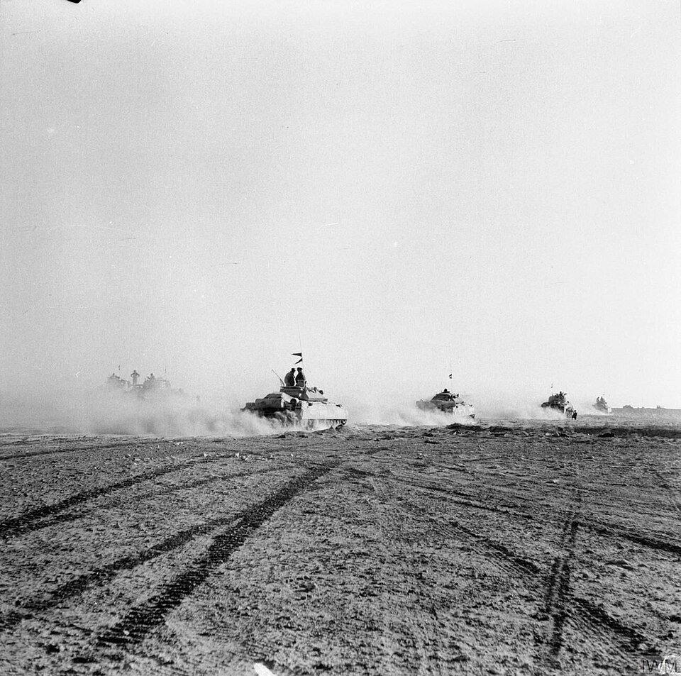

<!-- Generated from data/history/north_africa_1940_1942.json by python -m history. -->
# North Africa historical story, 1940–42

Historical reference only. Played results can differ. The linked research notes
hold detailed evidence and the open validation questions.

## Period summaries

### The Italian advance and the Sidi Barrani camps (1940-09-01–1940-12-08)

Trial chapters: italian_frontier_1940, italian_invasion_1940, italian_camps_1940

Archive image: Italian armoured vehicles heading toward Sidi Barrani, 17 September 1940. Italian state archive via Wikimedia Commons · CC0. [Source and reuse record](https://commons.wikimedia.org/wiki/File:Italian_armored_vehicles_heading_to_Sidi_Barrani.jpg).

**Before — objective:** Italy sought to advance from Libya into Egypt; the British covering force aimed to delay without losing its mobile strength before a defence at Matruh.

**Forces:** The Italian Tenth Army's advance used Libyan and Italian divisions and Maletti's mobile group. The British frontier screen included the 7th Armoured Division Support Group and 11th Hussars; this is a selected force summary, not a complete 1 September roster.

**Deployment:** The Support Group observed the Sollum–Fort Maddalena line. The 4th Blackshirt and 64th Catanzaro divisions were reserves near Tobruk before the advance.

Opening evidence: [UK1_11](https://www.ibiblio.org/hyperwar/UN/UK/UK-Med-I/UK-Med-I-11.html)

**Historical sequence:**

- 1940-09-13: The Italian advance crossed the frontier at Musaid and Sollum. [UK1_11](https://www.ibiblio.org/hyperwar/UN/UK/UK-Med-I/UK-Med-I-11.html)
- 1940-09-16: The Italian force reached the Sidi Barrani area and halted to develop road and water supply. [UK1_11](https://www.ibiblio.org/hyperwar/UN/UK/UK-Med-I/UK-Med-I-11.html)
- 1940-09-24: 7th Royal Tank Regiment reached Port Said after sailing from Britain; it was not part of the 1 September desert screen. [RTR_HISTORY](https://4and7royaltankregiment.com/1940-1941/)

**After — result:** Italian forces held Sidi Barrani and built separate forward camps; the British mobile force remained available for a counteroffensive.

**Why (source-based interpretation):** Transport, road and water limits constrained the Italian advance; the British screen avoided a costly fixed defence of the intervening ground.

Aftermath evidence: [UK1_11](https://www.ibiblio.org/hyperwar/UN/UK/UK-Med-I/UK-Med-I-11.html)

**Evidence limits:** Opening unit strengths, exact hexes, stocks and the complete 1 September order of battle are not validated.

Research notes: [FULL_CAMPAIGN_TRIAL_1940_1942.md](FULL_CAMPAIGN_TRIAL_1940_1942.md), [HISTORICAL_VALIDATION_LEDGER.md](HISTORICAL_VALIDATION_LEDGER.md)

### Operation Compass: Sidi Barrani to Beda Fomm (1940-12-09–1941-02-09)

Trial chapters: compass_opening, compass_interval, bardia_assault, tobruk_approach, tobruk_assault, derna_pursuit, beda_fomm_pursuit

Archive image: Australian 2/2nd Battalion troops in Bardia, 4 January 1941. Australian War Memorial 006083 via Wikimedia Commons · public domain. [Source and reuse record](https://commons.wikimedia.org/wiki/File:Bardia_AWM006083.jpg).

**Before — objective:** Western Desert Force planned to destroy the separated Italian camps around Nibeiwa and Tummar, then exploit toward Sidi Barrani and into Libya if successful.

**Forces:** The opening included 4th Indian Division, 7th Armoured Division and 7th Royal Tank Regiment against the Maletti Group and Libyan and Italian camp garrisons. 6th Australian Division later led the Bardia and Tobruk assaults. These are selected formations, not a complete order of battle.

**Deployment:** The Italian camps were spread around Nibeiwa, Tummar, Maktila, Rabia and Sofafi; the British assault assembled south of them.

Opening evidence: [WAVELL_COMPASS](https://www.ibiblio.org/hyperwar/UN/UK/LondonGazette/37628.pdf) [UK1_14](https://www.ibiblio.org/hyperwar/UN/UK/UK-Med-I/UK-Med-I-14.html) [UK1_15](https://www.ibiblio.org/hyperwar/UN/UK/UK-Med-I/UK-Med-I-15.html) [AU_BARDIA_ORDER](https://www.ibiblio.org/hyperwar/UN/Australia/Bengazi/Benghazi-B.html)

**Historical sequence:**

- 1940-12-09: Nibeiwa fell in the morning; 7th RTR then attacked Tummar West that afternoon. [UK1_14](https://www.ibiblio.org/hyperwar/UN/UK/UK-Med-I/UK-Med-I-14.html)
- 1940-12-10: Tummar East was occupied and Sidi Barrani town fell later that day. [UK1_14](https://www.ibiblio.org/hyperwar/UN/UK/UK-Med-I/UK-Med-I-14.html)
- 1940-12-14: 4th Indian Division left the Sidi Barrani battlefield for its next assignment; 16th British Brigade remained. [AU_BENGHAZI_6](https://www.ibiblio.org/hyperwar/UN/Australia/Bengazi/Benghazi-6.html)
- 1941-01-03: The 6th Australian Division assault breached the Bardia perimeter. [AU_BARDIA_ORDER](https://www.ibiblio.org/hyperwar/UN/Australia/Bengazi/Benghazi-B.html) [AU_BARDIA](https://www.awm.gov.au/collection/E84311)
- 1941-01-05: The remaining southern Bardia defences ceased resistance after the town had fallen on 4 January. [AU_BARDIA](https://www.awm.gov.au/collection/E84311)
- 1941-01-22: Tobruk fell after the Australian assault began on 21 January. [AU_TOBRUK](https://www.ibiblio.org/hyperwar/UN/Australia/Bengazi/Benghazi-9.html)
- 1941-01-30: Commonwealth forces entered Derna. [AU_DERNA](https://www.ibiblio.org/hyperwar/UN/Australia/Bengazi/Benghazi-10.html)
- 1941-02-07: The Italian retreat was cut near Beda Fomm and surrender followed by the morning. [AU_BEDA](https://www.ibiblio.org/hyperwar/UN/Australia/Bengazi/Benghazi-11.html)

**After — result:** The historical offensive captured Sidi Barrani, Bardia, Tobruk, Derna and Benghazi and destroyed the Italian Cyrenaican field position at Beda Fomm.

**Why (source-based interpretation):** Successive assaults broke the dispersed camps and fortresses; armoured pursuit cut the coast road during the Italian withdrawal. Australian transport shortages and British tank serviceability shaped the tempo.

Aftermath evidence: [UK1_14](https://www.ibiblio.org/hyperwar/UN/UK/UK-Med-I/UK-Med-I-14.html) [AU_TOBRUK](https://www.ibiblio.org/hyperwar/UN/Australia/Bengazi/Benghazi-9.html) [AU_BEDA](https://www.ibiblio.org/hyperwar/UN/Australia/Bengazi/Benghazi-11.html)

**Evidence limits:** The game does not resolve same-day multiple attacks by 7th RTR, local minefield breaches, tank serviceability or army-scale surrender; linked chapter openings are not independent historical deployments.

Research notes: [COMPASS_OPENING_RESEARCH.md](COMPASS_OPENING_RESEARCH.md), [BARDIA_OPENING_RESEARCH.md](BARDIA_OPENING_RESEARCH.md), [COMPASS_PURSUIT_RESEARCH.md](COMPASS_PURSUIT_RESEARCH.md)

### The Cyrenaica reversal and Tobruk siege (1941-02-10–1941-05-04)

Trial chapters: cyrenaica_preparation, cyrenaica_reversal, tobruk_siege_opening

Archive image: Australian 2/48th Battalion troops defend Tobruk, 24 April 1941. Australian War Memorial 020073 via Wikimedia Commons · public domain. [Source and reuse record](https://commons.wikimedia.org/wiki/File:AWM_020073_2_48th_Battalion_Tobruk_1941.jpg).

**Before — objective:** The Commonwealth intended to hold Cyrenaica with a reduced force while formations moved to Greece, preserving its mobile troops if compelled to withdraw.

**Forces:** 7th Armoured needed refit; 2nd Armoured and 9th Australian took up the defence. German and Italian mobile formations assembled in Libya. This is a selected formation summary.

**Deployment:** The forward defence extended from El Agheila through Benghazi; Tobruk was the major eastern port and fortress.

Opening evidence: [UK2_1](https://www.ibiblio.org/hyperwar/UN/UK/UK-Med-II/UK-Med-2-1.html) [AWM_TOBRUK](https://www.awm.gov.au/learn/schools/resources/tobruk-diaries/timeline)

**Historical sequence:**

- 1941-03-09: The 9th Australian Division was relieving the 6th Australian Division at Tobruk over 8–9 March. [AWM_TOBRUK](https://www.awm.gov.au/learn/schools/resources/tobruk-diaries/timeline)
- 1941-03-31: Axis troops attacked at Mersa Brega. [UK2_1](https://www.ibiblio.org/hyperwar/UN/UK/UK-Med-II/UK-Med-2-1.html)
- 1941-04-10: Axis forces began isolating Tobruk; the siege developed over 10–11 April. [AWM_TOBRUK](https://www.awm.gov.au/learn/schools/resources/tobruk-diaries/timeline)

**After — result:** The historical Commonwealth force retreated across Cyrenaica while Tobruk held out under siege.

**Why (source-based interpretation):** A thin, under-equipped defence faced the Axis advance; orders prioritised preserving the field force over holding Benghazi at any cost.

Aftermath evidence: [UK2_1](https://www.ibiblio.org/hyperwar/UN/UK/UK-Med-II/UK-Med-2-1.html) [AWM_TOBRUK](https://www.awm.gov.au/learn/schools/resources/tobruk-diaries/timeline)

**Evidence limits:** The trial's relief dates, entry hexes, strengths and supply mechanisms remain estimates. No historical retreat or capture is forced in a played campaign.

Research notes: [CYRENAICA_1941_RESEARCH.md](CYRENAICA_1941_RESEARCH.md)

### Frontier battles and relief preparations (1941-05-05–1941-09-29)

Trial chapters: frontier_preparation, brevity_frontier, halfaya_counterstroke, battleaxe_preparation, battleaxe_frontier, frontier_stalemate_1941, tobruk_relief_1941

Archive image: 4th Indian Division soldiers mark their lorry with 'Khyber pass to Hellfire Pass' after Battleaxe, 21 June 1941. IWM E3660, W. G. Vanderson via Wikimedia Commons · public domain. [Source and reuse record](https://commons.wikimedia.org/wiki/File:Soldiers_of_the_4th_Indian_Division_decorate_the_side_of_their_lorry,_North_Africa,_21_June_1941._E3660.jpg).

**Before — objective:** Commonwealth attacks on the frontier sought to open the way toward Tobruk; Axis defenders aimed to keep the frontier and continue the siege.

**Forces:** British armoured and infantry formations faced German and Italian mobile troops and prepared frontier positions; the Tobruk garrison was progressively relieved by sea. The exact 18 May and 15 June rosters still need verification.

**Deployment:** Halfaya, Sollum, Fort Capuzzo and the Egyptian frontier were the contested approaches while Tobruk remained isolated.

Opening evidence: [UK2_8](https://www.ibiblio.org/hyperwar/UN/UK/UK-Med-II/UK-Med-2-8.html) [AWM_TOBRUK](https://www.awm.gov.au/learn/schools/resources/tobruk-diaries/timeline)

**Historical sequence:**

- 1941-05-15: Operation Brevity began as a short frontier attack. [UK2_8](https://www.ibiblio.org/hyperwar/UN/UK/UK-Med-II/UK-Med-2-8.html)
- 1941-05-27: German forces retook Halfaya Pass after the May frontier fighting. [UK2_8](https://www.ibiblio.org/hyperwar/UN/UK/UK-Med-II/UK-Med-2-8.html) [UK2_CHRON](https://www.ibiblio.org/hyperwar/UN/UK/UK-Med-II/UK-Med-2-Chronology.html)
- 1941-06-15: Operation Battleaxe began; it ended without relieving Tobruk. [UK2_8](https://www.ibiblio.org/hyperwar/UN/UK/UK-Med-II/UK-Med-2-8.html)
- 1941-08-01: 5th Light Division was redesignated 21st Panzer Division; this was a change of name, not a new full-strength formation. [UK2_13](https://www.ibiblio.org/hyperwar/UN/UK/UK-Med-II/UK-Med-2-13.html)
- 1941-08-19: The first stage of Australian relief at Tobruk began in August. [UK2_CHRON](https://www.ibiblio.org/hyperwar/UN/UK/UK-Med-II/UK-Med-2-Chronology.html)
- 1941-09-19: The second stage of Australian relief at Tobruk began in September. [UK2_CHRON](https://www.ibiblio.org/hyperwar/UN/UK/UK-Med-II/UK-Med-2-Chronology.html)

**After — result:** The historical frontier attacks did not end the Tobruk siege. Both sides prepared for a larger autumn offensive, while the garrison relief proceeded by sea.

**Why (source-based interpretation):** Prepared Axis positions, armoured losses, repair and training needs, and supply limits shaped the pause after Battleaxe.

Aftermath evidence: [UK2_8](https://www.ibiblio.org/hyperwar/UN/UK/UK-Med-II/UK-Med-2-8.html) [UK2_13](https://www.ibiblio.org/hyperwar/UN/UK/UK-Med-II/UK-Med-2-13.html) [AWM_TOBRUK](https://www.awm.gov.au/learn/schools/resources/tobruk-diaries/timeline)

**Evidence limits:** The trial's frontier fort levels, tank availability, garrison relief timing and exact battle rosters are partly estimated. The source dates 5th Light's redesignation to 1 August; the game applies its identity-preserving name change on an approximate 15 August turn.

Research notes: [FRONTIER_1941_RESEARCH.md](FRONTIER_1941_RESEARCH.md), [BATTLEAXE_1941_RESEARCH.md](BATTLEAXE_1941_RESEARCH.md), [TOBRUK_PREPARATION_1941_RESEARCH.md](TOBRUK_PREPARATION_1941_RESEARCH.md)

### Operation Crusader and the relief of Tobruk (1941-09-30–1941-12-31)

Trial chapters: crusader_preparation_1941, crusader_linked_1941

Independent battles: crusader, sidi_rezegh

Archive image: A Crusader tank passes a burning German Panzer IV during Operation Crusader, 27 November 1941. IWM E6751, Lt L. B. Davies via Wikimedia Commons · public domain. [Source and reuse record](https://commons.wikimedia.org/wiki/File:Crusadertankandgermantank.jpg).

**Before — objective:** Eighth Army intended to defeat Axis armour, relieve Tobruk and recover Cyrenaica; the Axis sought to maintain the siege and hold its field position.

**Forces:** The planned Eighth Army force included XXX and XIII Corps, New Zealand and South African divisions and army tank brigades. Axis mobile formations included 15th and 21st Panzer, Ariete and Trieste. This is a selected summary, not a validated counter-level roster.

**Deployment:** Tobruk remained besieged; the British mobile concentration assembled to the east and south for the November offensive.

Opening evidence: [AUCHINLECK_CRUSADER](https://www.ibiblio.org/hyperwar/UN/UK/LondonGazette/38177.pdf) [UK2_15](https://www.ibiblio.org/hyperwar/UN/UK/UK-Med-II/UK-Med-2-15.html)

**Historical sequence:**

- 1941-10-04: The convoy carrying 22nd Armoured Brigade reached the theatre; desert preparation followed before field use. [UK2_13](https://www.ibiblio.org/hyperwar/UN/UK/UK-Med-II/UK-Med-2-13.html)
- 1941-11-18: Operation Crusader opened. [AUCHINLECK_CRUSADER](https://www.ibiblio.org/hyperwar/UN/UK/LondonGazette/38177.pdf)
- 1941-12-10: The last Australian battalion in Tobruk was evacuated after the relief rotation. [AWM_TOBRUK](https://www.awm.gov.au/learn/schools/resources/tobruk-diaries/timeline)

**After — result:** Historically the siege of Tobruk was lifted and Axis forces withdrew westward; the Eighth Army recovered Cyrenaica before the January reversal.

**Why (source-based interpretation):** Prolonged fighting exhausted the mobile formations and forced Axis withdrawal, while the Tobruk garrison and Eighth Army reconnected.

Aftermath evidence: [AUCHINLECK_CRUSADER](https://www.ibiblio.org/hyperwar/UN/UK/LondonGazette/38177.pdf)

**Evidence limits:** The linked trial inherits a counterfactual played front; its relief corridor and combat outcome are game abstractions.

Research notes: [TOBRUK_PREPARATION_1941_RESEARCH.md](TOBRUK_PREPARATION_1941_RESEARCH.md), [SIDI_REZEGH_OPENING_POSITIONS.md](SIDI_REZEGH_OPENING_POSITIONS.md), [SIDI_REZEGH_WINNABILITY.md](SIDI_REZEGH_WINNABILITY.md)

### The Axis return to Cyrenaica (1942-01-01–1942-02-08)

Trial chapters: cyrenaica_winter_1942, axis_january_offensive_1942

Archive image: Italian prisoners near Agedabia in January 1942, before the Axis counteroffensive. US Office of War Information / Library of Congress via Wikimedia Commons · public domain. [Source and reuse record](https://commons.wikimedia.org/wiki/File:Italian_prisoners_after_capture_during_an_engagement_near_Agedabia,_Libya,_January_1942_(37245568285).jpg).

**Before — objective:** The Axis sought to regain ground after Crusader; the Commonwealth tried to hold the line and preserve Tobruk and its mobile force.

**Forces:** Afrika Korps, 90th Light and Italian mobile troops opposed Eighth Army formations; unit-level 1942 strengths and serviceability remain unverified.

**Deployment:** The Axis had fallen back toward the Marada–Mersa Brega line by early January.

Opening evidence: [TOPPE](https://www.ibiblio.org/hyperwar/USA/CSI/CSI-Desert/toppe.asp.html)

**Historical sequence:**

- 1942-01-21: The Axis counterattack began. [TOPPE](https://www.ibiblio.org/hyperwar/USA/CSI/CSI-Desert/toppe.asp.html)
- 1942-01-30: Axis troops retook Benghazi. [TOPPE](https://www.ibiblio.org/hyperwar/USA/CSI/CSI-Desert/toppe.asp.html)
- 1942-02-07: The renewed advance halted short of Tobruk. [TOPPE](https://www.ibiblio.org/hyperwar/USA/CSI/CSI-Desert/toppe.asp.html)

**After — result:** The Axis regained Agedabia, Benghazi and Derna but did not immediately attack Tobruk.

**Why (source-based interpretation):** Fuel shortage and the condition of the troops limited further pursuit.

Aftermath evidence: [TOPPE](https://www.ibiblio.org/hyperwar/USA/CSI/CSI-Desert/toppe.asp.html)

**Evidence limits:** The current trial lacks tank repair, exact stocks and complete winter orders of battle.

Research notes: [CYRENAICA_WINTER_1942_RESEARCH.md](CYRENAICA_WINTER_1942_RESEARCH.md)

### Gazala, Tobruk and the retreat into Egypt (1942-02-09–1942-06-30)

Trial chapters: gazala_preparation_1942, gazala_battle_1942, egyptian_retreat_1942

Archive image: British 25-pounders firing at Gazala on the night of 2 June 1942. IWM E12789 via Wikimedia Commons · public domain. [Source and reuse record](https://commons.wikimedia.org/wiki/File:British_25-pounder_field_guns_in_action_on_the_night_of_2_June_1942_during_the_Battle_of_Gazala_in_Libya._E12789.jpg).

**Before — objective:** Eighth Army defended the Gazala line and Tobruk; Axis forces planned to break the line and exploit eastward.

**Forces:** The defence included 50th and South African formations and Free French at Bir Hakeim; Axis mobile forces included 90th Light, Ariete and Trieste. This is selected evidence, not a complete May roster.

**Deployment:** The Gazala position depended on fortified boxes, minefields and mobile reserves; the trial does not yet reproduce those systems faithfully.

Opening evidence: [COMMONS_GAZALA](https://www.ibiblio.org/pha/policy/1942/420602b.html) [AUCHINLECK_CRUSADER](https://www.ibiblio.org/hyperwar/UN/UK/LondonGazette/38177.pdf) [TOPPE](https://www.ibiblio.org/hyperwar/USA/CSI/CSI-Desert/toppe.asp.html)

**Historical sequence:**

- 1942-05-26: The Axis Gazala attack began. [TOPPE](https://www.ibiblio.org/hyperwar/USA/CSI/CSI-Desert/toppe.asp.html)
- 1942-06-21: Tobruk fell in the historical campaign. [TOPPE](https://www.ibiblio.org/hyperwar/USA/CSI/CSI-Desert/toppe.asp.html)
- 1942-06-30: The Axis advance approached El Alamein. [TOPPE](https://www.ibiblio.org/hyperwar/USA/CSI/CSI-Desert/toppe.asp.html)

**After — result:** The Gazala line collapsed, Tobruk was captured and Eighth Army retreated into Egypt.

**Why (source-based interpretation):** The mobile battle around the defended boxes, minefields and supply routes defeated the British position; the game does not yet model these causes adequately.

Aftermath evidence: [AUCHINLECK_CRUSADER](https://www.ibiblio.org/hyperwar/UN/UK/LondonGazette/38177.pdf) [TOPPE](https://www.ibiblio.org/hyperwar/USA/CSI/CSI-Desert/toppe.asp.html)

**Evidence limits:** Minefields, deliberate breaches, the Cauldron supply crisis, serviceable tank returns and exact unit strengths are open validation work.

Research notes: [CYRENAICA_WINTER_1942_RESEARCH.md](CYRENAICA_WINTER_1942_RESEARCH.md), [HISTORICAL_VALIDATION_LEDGER.md](HISTORICAL_VALIDATION_LEDGER.md)

### First Alamein and Alam Halfa (1942-07-01–1942-10-22)

Trial chapters: first_alamein_1942, august_buildup_1942, alam_halfa_1942, alamein_preparation_1942

Archive image: British infantry at a sandbagged position near El Alamein, 17 July 1942. IWM E14575, Sgt Fox via Wikimedia Commons · public domain. [Source and reuse record](https://commons.wikimedia.org/wiki/File:1stAlameinBritDefense.jpg).

**Before — objective:** Eighth Army had to stop the Axis advance at El Alamein; the Axis sought a breakthrough toward the Nile Delta.

**Forces:** The 9th Australian Division returned in July; later Eighth Army included XIII and XXX infantry corps and X Corps for armoured exploitation. The detailed order of battle remains incomplete in the trial.

**Deployment:** The Mediterranean and Qattara Depression narrowed the front near El Alamein.

Opening evidence: [AWM_ALAMEIN](https://www.awm.gov.au/collection/E84345) [MONTGOMERY](https://www.ibiblio.org/hyperwar/UN/UK/LondonGazette/38196.pdf)

**Historical sequence:**

- 1942-07-01: The First Battle of El Alamein began after the Axis pursuit reached Egypt. [AWM_ALAMEIN](https://www.awm.gov.au/collection/E84345)
- 1942-07-04: The 9th Australian Division returned to the battle area. [AWM_ALAMEIN](https://www.awm.gov.au/collection/E84345)
- 1942-08-30: The Axis Alam Halfa attack opened. [AWM_ALAMEIN](https://www.awm.gov.au/collection/E84345)

**After — result:** The Axis advance was stopped at Alamein and the Alam Halfa attack failed; Eighth Army prepared its own offensive.

**Why (source-based interpretation):** The constrained front and strengthened British defence limited Axis manoeuvre while reinforcements and training built Eighth Army's strength.

Aftermath evidence: [AWM_ALAMEIN](https://www.awm.gov.au/collection/E84345) [MONTGOMERY](https://www.ibiblio.org/hyperwar/UN/UK/LondonGazette/38196.pdf)

**Evidence limits:** The trial's minefields, training, tank serviceability and late-1942 brigade detail remain incomplete.

Research notes: [HISTORICAL_VALIDATION_LEDGER.md](HISTORICAL_VALIDATION_LEDGER.md), [FULL_CAMPAIGN_TRIAL_1940_1942.md](FULL_CAMPAIGN_TRIAL_1940_1942.md)

### Second Alamein and the westward pursuit (1942-10-23–1942-11-30)

Trial chapters: second_alamein_1942, november_pursuit_1942

Archive image: British tanks moving into the Second Battle of El Alamein, 24 October 1942. IWM E18481, Sgt Gladstone via Wikimedia Commons · public domain. [Source and reuse record](https://commons.wikimedia.org/wiki/File:El_Alamein_1942_-_British_tanks.jpg).

**Before — objective:** Eighth Army planned to breach the Axis position, defeat its armour and pursue west; Axis forces aimed to hold the Alamein line.

**Forces:** X Corps was the armoured exploitation force, while XIII and XXX Corps supplied major infantry formations. The trial's detailed roster and serviceable equipment are not yet verified.

**Deployment:** The opposing armies faced each other across the fortified Alamein line and its minefields.

Opening evidence: [MONTGOMERY](https://www.ibiblio.org/hyperwar/UN/UK/LondonGazette/38196.pdf)

**Historical sequence:**

- 1942-10-23: Eighth Army opened the Second Battle of El Alamein. [AWM_ALAMEIN](https://www.awm.gov.au/collection/E84345) [MONTGOMERY](https://www.ibiblio.org/hyperwar/UN/UK/LondonGazette/38196.pdf)
- 1942-11-05: The battle had broken the Axis position and the westward pursuit followed. [MONTGOMERY](https://www.ibiblio.org/hyperwar/UN/UK/LondonGazette/38196.pdf) [TOPPE](https://www.ibiblio.org/hyperwar/USA/CSI/CSI-Desert/toppe.asp.html)

**After — result:** The Axis army withdrew west from Egypt and Eighth Army pursued across the frontier during November.

**Why (source-based interpretation):** The British offensive breached the defended line and wore down Axis mobile resistance; the detailed mine-clearing and logistics that made this possible are not reproduced in the trial.

Aftermath evidence: [MONTGOMERY](https://www.ibiblio.org/hyperwar/UN/UK/LondonGazette/38196.pdf) [TOPPE](https://www.ibiblio.org/hyperwar/USA/CSI/CSI-Desert/toppe.asp.html)

**Evidence limits:** The game can assess a played final strategic position, but that verdict must never be presented as the historical 1942 outcome.

Research notes: [HISTORICAL_VALIDATION_LEDGER.md](HISTORICAL_VALIDATION_LEDGER.md), [FULL_CAMPAIGN_TRIAL_1940_1942.md](FULL_CAMPAIGN_TRIAL_1940_1942.md)

## Battle and operation records

### The Italian advance into Egypt (1940-09-13–1940-09-17)

Trial chapters: italian_invasion_1940

**Before — objective:** The Italian Tenth Army was ordered into Egypt; the British screen was to delay and warn without sacrificing the mobile force needed to defend Matruh.

**Forces:** The advance used Libyan divisions, Maletti's mobile group and Italian reserves. The British screen included the 7th Armoured Support Group and 11th Hussars.

**Deployment:** The British Support Group observed the Sollum–Fort Maddalena frontier. Italian forces assembled west of Sollum; the 4th Blackshirt and 64th Catanzaro divisions remained near Tobruk as reserves.

Opening evidence: [UK1_11](https://www.ibiblio.org/hyperwar/UN/UK/UK-Med-I/UK-Med-I-11.html)

**Historical sequence:**

- 1940-09-13 · battle: Italian troops took Musaid and advanced through Sollum after an artillery opening. [UK1_11](https://www.ibiblio.org/hyperwar/UN/UK/UK-Med-I/UK-Med-I-11.html)
- 1940-09-16 · movement: The Italian advance reached Sidi Barrani and then halted. [UK1_11](https://www.ibiblio.org/hyperwar/UN/UK/UK-Med-I/UK-Med-I-11.html)

**After — result:** Italy held a forward position at Sidi Barrani but did not continue to Matruh. British mobile forces withdrew in good order toward their planned defence.

**Why (source-based interpretation):** Road and water works, limited motor transport and a British delaying screen constrained the advance.

Aftermath evidence: [UK1_11](https://www.ibiblio.org/hyperwar/UN/UK/UK-Med-I/UK-Med-I-11.html)

**Evidence limits:** The full 13 September unit roster, strength returns and exact 10 km deployment are not validated.

Research notes: [FULL_CAMPAIGN_TRIAL_1940_1942.md](FULL_CAMPAIGN_TRIAL_1940_1942.md), [HISTORICAL_VALIDATION_LEDGER.md](HISTORICAL_VALIDATION_LEDGER.md)

### Nibeiwa, Tummar and Sidi Barrani (1940-12-09–1940-12-11)

Trial chapters: compass_opening

**Before — objective:** Western Desert Force planned a surprise attack through the gap between Italian camps, destroying Nibeiwa and Tummar before turning on Sidi Barrani.

**Forces:** 4th Indian Division, 7th Armoured Division and 7th Royal Tank Regiment faced the Maletti Group, two Libyan divisions and other Italian camp defenders. 16th British Brigade remained after 4th Indian Division's departure.

**Deployment:** The Italian camps lay separately at Nibeiwa, Tummar, Maktila, Rabia and Sofafi. British armour and infantry assembled south of the camps for the concealed approach.

Opening evidence: [WAVELL_COMPASS](https://www.ibiblio.org/hyperwar/UN/UK/LondonGazette/37628.pdf) [UK1_14](https://www.ibiblio.org/hyperwar/UN/UK/UK-Med-I/UK-Med-I-14.html) [AU_BENGHAZI_6](https://www.ibiblio.org/hyperwar/UN/Australia/Bengazi/Benghazi-6.html)

**Historical sequence:**

- 1940-12-09 · battle: 11th Indian Brigade and 7th RTR overran Nibeiwa; the tanks then attacked Tummar West that afternoon. [UK1_14](https://www.ibiblio.org/hyperwar/UN/UK/UK-Med-I/UK-Med-I-14.html) [AU_BENGHAZI_6](https://www.ibiblio.org/hyperwar/UN/Australia/Bengazi/Benghazi-6.html)
- 1940-12-10 · battle: Tummar East was occupied and Sidi Barrani town fell late in the day. [AU_BENGHAZI_6](https://www.ibiblio.org/hyperwar/UN/Australia/Bengazi/Benghazi-6.html)
- 1940-12-11 · result: Isolated Italian positions continued surrendering after the town's fall. [AU_BENGHAZI_6](https://www.ibiblio.org/hyperwar/UN/Australia/Bengazi/Benghazi-6.html)

**After — result:** The Italian camp system around Sidi Barrani was broken and the Commonwealth advance could continue toward Bardia.

**Why (source-based interpretation):** Surprise, separated camps and the concentrated infantry-tank assault let a smaller force defeat the local positions in sequence.

Aftermath evidence: [WAVELL_COMPASS](https://www.ibiblio.org/hyperwar/UN/UK/LondonGazette/37628.pdf) [UK1_14](https://www.ibiblio.org/hyperwar/UN/UK/UK-Med-I/UK-Med-I-14.html) [AU_BENGHAZI_6](https://www.ibiblio.org/hyperwar/UN/Australia/Bengazi/Benghazi-6.html)

**Evidence limits:** The game cannot reproduce 7th RTR's two same-day assaults or distinguish working tanks from temporarily unserviceable ones. 4th Indian Division's historical 14 December departure is beyond this battle record but remains in the period timeline and research note.

Research notes: [COMPASS_OPENING_RESEARCH.md](COMPASS_OPENING_RESEARCH.md)

### The assault on Bardia (1941-01-03–1941-01-05)

Trial chapters: bardia_assault

**Before — objective:** 6th Australian Division was ordered to breach Bardia's central and southern defences, capture the town and overcome the remaining perimeter; the Italian garrison sought to hold the fortress and port.

**Forces:** 16th and 17th Australian Brigades, 7th RTR, engineers and artillery made the principal assault; 19th Australian Brigade covered and followed. Italian formations included parts of the Blackshirt, Marmarica, Cirene and Catanzaro divisions with fortress troops.

**Deployment:** The Italians occupied an extensive perimeter, posts, artillery and the town. The first Australian phase attacked the western and southern sector rather than the town alone.

Opening evidence: [AU_BARDIA_ORDER](https://www.ibiblio.org/hyperwar/UN/Australia/Bengazi/Benghazi-B.html) [UK1_15](https://www.ibiblio.org/hyperwar/UN/UK/UK-Med-I/UK-Med-I-15.html) [AU_BARDIA](https://www.awm.gov.au/collection/E84311)

**Historical sequence:**

- 1941-01-03 · battle: The Australian attack breached the perimeter in two planned phases. [AU_BARDIA_ORDER](https://www.ibiblio.org/hyperwar/UN/Australia/Bengazi/Benghazi-B.html) [AU_BARDIA](https://www.awm.gov.au/collection/E84311)
- 1941-01-04 · battle: Bardia town was captured late in the day while resistance persisted farther south. [AU_BARDIA](https://www.awm.gov.au/collection/E84311)
- 1941-01-05 · result: The southern perimeter's remaining resistance ended. [AU_BARDIA](https://www.awm.gov.au/collection/E84311)

**After — result:** The Commonwealth captured Bardia and its garrison; the pursuit toward Tobruk proceeded.

**Why (source-based interpretation):** A prepared infantry, engineer, artillery and tank assault broke the perimeter, then cleared positions that remained after the town fell.

Aftermath evidence: [AU_BARDIA_ORDER](https://www.ibiblio.org/hyperwar/UN/Australia/Bengazi/Benghazi-B.html) [AU_BARDIA](https://www.awm.gov.au/collection/E84311) [UK1_15](https://www.ibiblio.org/hyperwar/UN/UK/UK-Med-I/UK-Med-I-15.html)

**Evidence limits:** The source's roughly 45,000 defenders and 23 serviceable 7th RTR tanks are aggregate and availability figures, not individual game counter strengths. The trial's 10 km hexes cannot represent perimeter posts, mines or breaches.

Research notes: [BARDIA_OPENING_RESEARCH.md](BARDIA_OPENING_RESEARCH.md)

### The capture of Tobruk (1941-01-21–1941-01-22)

Trial chapters: tobruk_assault

**Before — objective:** The Commonwealth aimed to capture Tobruk's fortified port and continue west; the Italian XXII Corps and garrison sought to hold its perimeter and harbour.

**Forces:** 6th Australian Division's brigades, supported by 7th RTR, artillery and air forces, attacked an Italian defence including 61st Sirte Division, fortress troops and guns. The 7th Armoured Division screened the western approaches.

**Deployment:** The Australian attack faced an outer defended perimeter south of the port. Armoured forces moved by the inland Capuzzo–El Adem route while the Australians approached along the coast-road axis.

Opening evidence: [AU_TOBRUK](https://www.ibiblio.org/hyperwar/UN/Australia/Bengazi/Benghazi-9.html) [UK1_15](https://www.ibiblio.org/hyperwar/UN/UK/UK-Med-I/UK-Med-I-15.html)

**Historical sequence:**

- 1941-01-21 · battle: The detailed Australian official history describes the main perimeter assault on this day. [AU_TOBRUK](https://www.ibiblio.org/hyperwar/UN/Australia/Bengazi/Benghazi-9.html)
- 1941-01-22 · result: Australian forces entered Tobruk and the Italian command surrendered in the detailed official account. [AU_TOBRUK](https://www.ibiblio.org/hyperwar/UN/Australia/Bengazi/Benghazi-9.html)

**After — result:** Tobruk fell and became the Commonwealth's forward port for the Cyrenaican pursuit.

**Why (source-based interpretation):** A breach of the perimeter and the collapse of the Italian inner defence opened the town and harbour; the armoured screen limited retreat westward.

Aftermath evidence: [AU_TOBRUK](https://www.ibiblio.org/hyperwar/UN/Australia/Bengazi/Benghazi-9.html) [UK1_15](https://www.ibiblio.org/hyperwar/UN/UK/UK-Med-I/UK-Med-I-15.html)

**Evidence limits:** The detailed Australian official history places the assault and fall on 21–22 January; the AWM overview describes 22–23 January. The discrepancy is preserved for source review. Italian garrison totals and game-counter strengths are not interchangeable.

Research notes: [COMPASS_PURSUIT_RESEARCH.md](COMPASS_PURSUIT_RESEARCH.md)

**Source discrepancy — Date of the assault and fall:**

- Assault on 21 January; town taken on 22 January [AU_TOBRUK](https://www.ibiblio.org/hyperwar/UN/Australia/Bengazi/Benghazi-9.html)
- Assault on 22 January; town taken on 23 January [AWM_TOBRUK_BATTLES](https://www.awm.gov.au/collection/E84833)

### The pursuit through Mechili and Derna (1941-01-23–1941-01-30)

Trial chapters: derna_pursuit

**Before — objective:** Commonwealth forces pursued the Italian withdrawal west from Tobruk, seeking the roads through Mechili and Derna; Axis rearguards attempted to delay them.

**Forces:** 7th Armoured Division advanced on the inland route and 6th Australian Division moved on the northern routes. Italian rearguards included 60th Sabratha and Babini armour in contemporary reports.

**Deployment:** The armoured route ran toward Mechili; Australian formations moved through the Jebel Akhdar approaches to Derna. Exact dated strengths and locations of the western Italian groups remain open.

Opening evidence: [AU_TOBRUK](https://www.ibiblio.org/hyperwar/UN/Australia/Bengazi/Benghazi-9.html) [AU_DERNA](https://www.ibiblio.org/hyperwar/UN/Australia/Bengazi/Benghazi-10.html)

**Historical sequence:**

- 1941-01-23 · movement: The westward pursuit continued after Tobruk, with armoured movement toward Mechili and an Australian advance on the northern roads. [AU_DERNA](https://www.ibiblio.org/hyperwar/UN/Australia/Bengazi/Benghazi-10.html)
- 1941-01-30 · result: Commonwealth troops entered Derna after rearguard fighting. [AU_DERNA](https://www.ibiblio.org/hyperwar/UN/Australia/Bengazi/Benghazi-10.html)

**After — result:** Derna passed to the Commonwealth and the Italian withdrawal continued toward Benghazi and Beda Fomm.

**Why (source-based interpretation):** The northern infantry pursuit and inland armoured movement threatened the remaining Italian routes, though transport constrained how quickly Australian brigades could move.

Aftermath evidence: [AU_DERNA](https://www.ibiblio.org/hyperwar/UN/Australia/Bengazi/Benghazi-10.html) [AU_BEDA](https://www.ibiblio.org/hyperwar/UN/Australia/Bengazi/Benghazi-11.html)

**Evidence limits:** The game's 23 January entry date for western Axis counters is a modelling device, not evidence of their arrival in Libya. Their identities and strengths still need dated records.

Research notes: [COMPASS_PURSUIT_RESEARCH.md](COMPASS_PURSUIT_RESEARCH.md)

### The road block at Beda Fomm (1941-02-03–1941-02-07)

Trial chapters: beda_fomm_pursuit

**Before — objective:** The Commonwealth aimed to intercept the Italian withdrawal from Benghazi before it escaped south; Italian forces sought to keep the coast road open.

**Forces:** 7th Armoured Division made the inland interception while 6th Australian Division pursued through the Jebel Akhdar. The Italian retreat comprised the remaining Cyrenaican field forces, whose local composition and serviceability varied.

**Deployment:** Aircraft observed Italian columns withdrawing west from Benghazi. British armour moved from Mechili toward the coast-road crossing near Beda Fomm.

Opening evidence: [AU_BEDA](https://www.ibiblio.org/hyperwar/UN/Australia/Bengazi/Benghazi-11.html)

**Historical sequence:**

- 1941-02-03 · movement: Air reconnaissance found the Italian withdrawal; O'Connor accelerated the armoured interception. [AU_BEDA](https://www.ibiblio.org/hyperwar/UN/Australia/Bengazi/Benghazi-11.html)
- 1941-02-07 · result: The road block held and Italian surrender followed by the morning. [AU_BEDA](https://www.ibiblio.org/hyperwar/UN/Australia/Bengazi/Benghazi-11.html)

**After — result:** The Italian withdrawal was cut at Beda Fomm and the remaining Cyrenaican field force surrendered.

**Why (source-based interpretation):** The inland armoured move reached the coast road ahead of the retreat while Australian pursuit kept pressure from the north.

Aftermath evidence: [AU_BEDA](https://www.ibiblio.org/hyperwar/UN/Australia/Bengazi/Benghazi-11.html)

**Evidence limits:** The engine does not model army-scale surrender when one road hex is reached. Australian transport shortages allowed only part of the infantry to advance quickly at once.

Research notes: [COMPASS_PURSUIT_RESEARCH.md](COMPASS_PURSUIT_RESEARCH.md)

### The April reversal across Cyrenaica (1941-04-01–1941-04-11)

Trial chapters: cyrenaica_reversal

**Before — objective:** Axis forces pressed east from Mersa Brega; Commonwealth commanders were ordered to delay while preserving their reduced field force and Tobruk.

**Forces:** 2nd Armoured Division and 9th Australian Division faced German and Italian mobile formations. The British armoured force was weak and short of serviceable vehicles; the Australians lacked equipment and transport.

**Deployment:** The British Support Group held Mersa Brega through 31 March, then withdrew. The following defence and withdrawal routes ran through Benghazi, Mechili and toward Tobruk.

Opening evidence: [UK2_1](https://www.ibiblio.org/hyperwar/UN/UK/UK-Med-II/UK-Med-2-1.html) [UK2_2](https://www.ibiblio.org/hyperwar/UN/UK/UK-Med-II/UK-Med-2-2.html)

**Historical sequence:**

- 1941-04-01 · movement: German forces occupied Mersa Brega after the British withdrawal. [UK2_2](https://www.ibiblio.org/hyperwar/UN/UK/UK-Med-II/UK-Med-2-2.html)
- 1941-04-04 · movement: German reconnaissance reached Benghazi as the Commonwealth retreat continued. [UK2_2](https://www.ibiblio.org/hyperwar/UN/UK/UK-Med-II/UK-Med-2-2.html)
- 1941-04-11 · result: Axis forces reached the Tobruk area while the port's defence held. [UK2_CHRON](https://www.ibiblio.org/hyperwar/UN/UK/UK-Med-II/UK-Med-2-Chronology.html) [AWM_TOBRUK](https://www.awm.gov.au/learn/schools/resources/tobruk-diaries/timeline)

**After — result:** The Commonwealth lost most of Cyrenaica but retained Tobruk, which became a besieged port.

**Why (source-based interpretation):** A thin, mechanically weak defence withdrew under mobile pressure; holding Tobruk preserved a coastal obstacle to Axis supply and advance.

Aftermath evidence: [UK2_2](https://www.ibiblio.org/hyperwar/UN/UK/UK-Med-II/UK-Med-2-2.html) [AWM_TOBRUK_BATTLES](https://www.awm.gov.au/collection/E84833)

**Evidence limits:** The game carries whatever front the player has made. Its April entry dates, strengths and 10 km positions are partly estimated, and a map approach to Tobruk is not a siege model.

Research notes: [CYRENAICA_1941_RESEARCH.md](CYRENAICA_1941_RESEARCH.md)

### The opening battles of the Tobruk siege (1941-04-12–1941-05-04)

Trial chapters: tobruk_siege_opening

**Before — objective:** The 9th Australian garrison was to deny Tobruk's port to the Axis and delay its advance; Axis commanders sought to seize the fortress.

**Forces:** 9th Australian Division, reinforced by 18th Australian Brigade and other Commonwealth troops, defended the perimeter against German and Italian forces including 5th Light, 15th Panzer, Ariete and Brescia elements.

**Deployment:** The defenders held Tobruk's perimeter posts, minefields and harbour while supply arrived by sea. Axis attacks focused on selected perimeter sectors rather than the whole 10 km map hex.

Opening evidence: [AWM_TOBRUK_BATTLES](https://www.awm.gov.au/collection/E84833) [UK2_8](https://www.ibiblio.org/hyperwar/UN/UK/UK-Med-II/UK-Med-2-8.html)

**Historical sequence:**

- 1941-04-14 · battle: The Easter attack was repelled after fighting around the perimeter. [AWM_TOBRUK](https://www.awm.gov.au/learn/schools/resources/tobruk-diaries/timeline) [AWM_TOBRUK_BATTLES](https://www.awm.gov.au/collection/E84833)
- 1941-04-30 · battle: A renewed Axis attack began around Ras el Medauar and the salient. [UK2_8](https://www.ibiblio.org/hyperwar/UN/UK/UK-Med-II/UK-Med-2-8.html) [AWM_TOBRUK](https://www.awm.gov.au/learn/schools/resources/tobruk-diaries/timeline)
- 1941-05-04 · result: The battle for the salient had not yielded Tobruk's port to the Axis. [AWM_TOBRUK](https://www.awm.gov.au/learn/schools/resources/tobruk-diaries/timeline) [UK2_8](https://www.ibiblio.org/hyperwar/UN/UK/UK-Med-II/UK-Med-2-8.html)

**After — result:** The Axis failed to take Tobruk in the opening siege battles; the garrison continued to hold and be supplied by sea.

**Why (source-based interpretation):** Prepared posts, minefields, artillery and naval supply let the garrison withstand attacks against limited sectors.

Aftermath evidence: [UK2_8](https://www.ibiblio.org/hyperwar/UN/UK/UK-Med-II/UK-Med-2-8.html) [AWM_TOBRUK_BATTLES](https://www.awm.gov.au/collection/E84833)

**Evidence limits:** The trial has no local perimeter-post, mine-breach or naval-resupply battle model. Its opening roster is a carried campaign state, not a validated 12 April deployment.

Research notes: [CYRENAICA_1941_RESEARCH.md](CYRENAICA_1941_RESEARCH.md)

### Operation Brevity (1941-05-15–1941-05-17)

Trial chapters: brevity_frontier

**Before — objective:** Wavell ordered a frontier attack to clear Sollum and Capuzzo, inflict losses and exploit toward Tobruk only if supply and the safety of the force allowed.

**Forces:** 7th Armoured Brigade Group, 22nd Guards Brigade Group with 4th RTR infantry tanks, and a coast group built around 2nd Rifle Brigade and artillery made the Commonwealth attack. Axis troops defended the frontier and could counterattack.

**Deployment:** The British plan used a desert flank, a central attack and a coastal group against Halfaya, Sollum and Capuzzo.

Opening evidence: [UK2_8](https://www.ibiblio.org/hyperwar/UN/UK/UK-Med-II/UK-Med-2-8.html)

**Historical sequence:**

- 1941-05-15 · battle: The Commonwealth frontier attack began. [UK2_8](https://www.ibiblio.org/hyperwar/UN/UK/UK-Med-II/UK-Med-2-8.html)
- 1941-05-16 · battle: Axis counterattack and British withdrawal followed the initial gains. [UK2_8](https://www.ibiblio.org/hyperwar/UN/UK/UK-Med-II/UK-Med-2-8.html)

**After — result:** The short attack did not open a lasting route to Tobruk.

**Why (source-based interpretation):** The operation was a bounded probe with limited forces and supply, and Axis reaction prevented exploitation.

Aftermath evidence: [UK2_8](https://www.ibiblio.org/hyperwar/UN/UK/UK-Med-II/UK-Med-2-8.html)

**Evidence limits:** The 29 cruiser and 24 infantry tanks are source figures for particular groups; the game's manpower, entry hexes and 5 May preparation arrivals are estimates.

Research notes: [FRONTIER_1941_RESEARCH.md](FRONTIER_1941_RESEARCH.md)

### The Halfaya counterstroke (1941-05-26–1941-05-27)

Trial chapters: halfaya_counterstroke

**Before — objective:** Axis forces sought to retake Halfaya Pass after the British frontier probe; the Commonwealth aimed to keep its forward foothold.

**Forces:** German and Italian frontier troops faced the British groups left around Halfaya and Sollum after Brevity. A complete dated local roster still needs verification.

**Deployment:** Halfaya was the escarpment pass controlling the coastal route; its approaches could be defended from above and below the escarpment.

Opening evidence: [UK2_8](https://www.ibiblio.org/hyperwar/UN/UK/UK-Med-II/UK-Med-2-8.html) [UK2_CHRON](https://www.ibiblio.org/hyperwar/UN/UK/UK-Med-II/UK-Med-2-Chronology.html)

**Historical sequence:**

- 1941-05-26 · battle: German troops attacked the Halfaya position. [UK2_8](https://www.ibiblio.org/hyperwar/UN/UK/UK-Med-II/UK-Med-2-8.html)
- 1941-05-27 · result: Axis troops recovered Halfaya Pass. [UK2_8](https://www.ibiblio.org/hyperwar/UN/UK/UK-Med-II/UK-Med-2-8.html) [UK2_CHRON](https://www.ibiblio.org/hyperwar/UN/UK/UK-Med-II/UK-Med-2-Chronology.html)

**After — result:** Halfaya returned to Axis control before Battleaxe.

**Why (source-based interpretation):** The counterattack displaced the limited British frontier force and restored the Axis defensive position at the pass.

Aftermath evidence: [UK2_8](https://www.ibiblio.org/hyperwar/UN/UK/UK-Med-II/UK-Med-2-8.html)

**Evidence limits:** The linked chapter spans 18–27 May; only 26–27 May is the dated historical counterstroke. Local force strengths and map-scale fortifications remain open.

Research notes: [BATTLEAXE_1941_RESEARCH.md](BATTLEAXE_1941_RESEARCH.md)

### Operation Battleaxe (1941-06-15–1941-06-17)

Trial chapters: battleaxe_frontier

**Before — objective:** Wavell planned first to defeat the Axis frontier force and secure the Bardia–Sollum–Capuzzo area, then attack forces near Tobruk and exploit west if the first phase succeeded.

**Forces:** 4th Indian Division, 7th Armoured Division, 7th RTR and other Commonwealth groups faced 15th Panzer, 5th Light, Italian mobile troops and prepared frontier positions. The official history gives roughly 90 cruiser and 100 infantry tanks at the start, not counter-level readiness.

**Deployment:** The British assault had a coastal Halfaya attack, a Capuzzo centre and an armoured desert flank toward Hafid Ridge. Axis anti-tank positions, mines and mobile reserves defended the approaches.

Opening evidence: [UK2_8](https://www.ibiblio.org/hyperwar/UN/UK/UK-Med-II/UK-Med-2-8.html)

**Historical sequence:**

- 1941-06-15 · battle: The attack failed at Halfaya, gained ground at Capuzzo and was checked at Hafid Ridge. [UK2_8](https://www.ibiblio.org/hyperwar/UN/UK/UK-Med-II/UK-Med-2-8.html)
- 1941-06-16 · battle: Axis mobile counterattacks struck while Commonwealth armour and infantry tried to consolidate. [UK2_8](https://www.ibiblio.org/hyperwar/UN/UK/UK-Med-II/UK-Med-2-8.html)
- 1941-06-17 · result: The Commonwealth offensive was called off without relieving Tobruk. [UK2_8](https://www.ibiblio.org/hyperwar/UN/UK/UK-Med-II/UK-Med-2-8.html) [UK2_CHRON](https://www.ibiblio.org/hyperwar/UN/UK/UK-Med-II/UK-Med-2-Chronology.html)

**After — result:** Battleaxe failed to open the route to Tobruk; the frontier and siege remained contested.

**Why (source-based interpretation):** Concealed anti-tank guns, mines, breakdowns and Axis mobile reaction disrupted the three-pronged plan, while gains at Capuzzo could not be exploited.

Aftermath evidence: [UK2_8](https://www.ibiblio.org/hyperwar/UN/UK/UK-Med-II/UK-Med-2-8.html)

**Evidence limits:** The game lacks detailed tank serviceability, concealed gun positions, Hafid Ridge terrain and a second-phase Tobruk attack. Its 1 June reinforcement date and exact strengths are model estimates.

Research notes: [BATTLEAXE_1941_RESEARCH.md](BATTLEAXE_1941_RESEARCH.md)

### Operation Crusader (1941-11-18–1941-12-31)

Trial chapters: crusader_linked_1941

Independent battles: crusader

**Before — objective:** Eighth Army sought to destroy Axis armour, relieve Tobruk and retake Cyrenaica; Axis forces sought to keep the siege and their frontier position.

**Forces:** XXX and XIII Corps, New Zealand and South African divisions and army tank brigades faced 15th and 21st Panzer, Ariete, Trieste and other Axis formations. The linked campaign's exact counter strengths and entry dates are not historical returns.

**Deployment:** The Eighth Army assembled east of the frontier and advanced toward Sidi Rezegh and Tobruk; Axis mobile formations were dispersed around the siege and frontier and later concentrated in reaction.

Opening evidence: [AUCHINLECK_CRUSADER](https://www.ibiblio.org/hyperwar/UN/UK/LondonGazette/38177.pdf) [UK2_15](https://www.ibiblio.org/hyperwar/UN/UK/UK-Med-II/UK-Med-2-15.html) [AWM_ED_DUDA](https://www.awm.gov.au/collection/C1417191)

**Historical sequence:**

- 1941-11-18 · battle: Eighth Army opened Crusader with an advance into Cyrenaica. [AUCHINLECK_CRUSADER](https://www.ibiblio.org/hyperwar/UN/UK/LondonGazette/38177.pdf) [NZ_TIMELINE](https://nzhistory.govt.nz/war/the-north-african-campaign/timeline)
- 1941-11-26 · movement: New Zealand troops linked toward the Tobruk garrison after taking Sidi Rezegh and Belhamed. [NZ_TIMELINE](https://nzhistory.govt.nz/war/the-north-african-campaign/timeline) [AWM_ED_DUDA](https://www.awm.gov.au/collection/C1417191)
- 1941-12-02 · withdrawal: The New Zealand Division withdrew from Libya after heavy fighting. [NZ_TIMELINE](https://nzhistory.govt.nz/war/the-north-african-campaign/timeline)
- 1941-12-10 · result: The Tobruk siege was lifted in the historical campaign. [NZ_TIMELINE](https://nzhistory.govt.nz/war/the-north-african-campaign/timeline) [AUCHINLECK_CRUSADER](https://www.ibiblio.org/hyperwar/UN/UK/LondonGazette/38177.pdf)
- 1941-12-24 · movement: Commonwealth forces retook Benghazi during the westward pursuit. [NZ_TIMELINE](https://nzhistory.govt.nz/war/the-north-african-campaign/timeline)

**After — result:** Tobruk was relieved and Axis forces withdrew across Cyrenaica.

**Why (source-based interpretation):** Attritional mobile fighting, pressure from the Tobruk garrison and Eighth Army's continued advance broke the siege and forced an Axis withdrawal.

Aftermath evidence: [AUCHINLECK_CRUSADER](https://www.ibiblio.org/hyperwar/UN/UK/LondonGazette/38177.pdf) [NZ_TIMELINE](https://nzhistory.govt.nz/war/the-north-african-campaign/timeline)

**Evidence limits:** The independent Crusader start and linked campaign start are different. The linked trial's relief corridor, reinforcement readiness and losses remain game abstractions.

Research notes: [TOBRUK_PREPARATION_1941_RESEARCH.md](TOBRUK_PREPARATION_1941_RESEARCH.md), [SIDI_REZEGH_OPENING_POSITIONS.md](SIDI_REZEGH_OPENING_POSITIONS.md)

### The fighting at Sidi Rezegh and Belhamed (1941-11-19–1941-11-27)

Independent battles: sidi_rezegh

**Before — objective:** The Commonwealth advance sought the Sidi Rezegh airfield and a connection to Tobruk; Axis troops sought to deny the route and defeat the attacking armour.

**Forces:** 7th Armoured Brigade and New Zealand formations fought around the airfield and Point 175; German panzer divisions, Afrika Division infantry, Italian armour around Bir el Gubi and Tobruk garrison troops reacted. Exact 18 November regimental locations remain under review.

**Deployment:** On 18 November the airfield was not held by the full German infantry formation later fighting nearby. Ariete was around Bir el Gubi; German troops around the Tobruk siege ring moved toward the airfield after the British advance.

Opening evidence: [AWM_ED_DUDA](https://www.awm.gov.au/collection/C1417191) [NZ_TIMELINE](https://nzhistory.govt.nz/war/the-north-african-campaign/timeline)

**Historical sequence:**

- 1941-11-19 · battle: 7th Armoured Brigade seized the Sidi Rezegh airfield against light resistance. [AWM_ED_DUDA](https://www.awm.gov.au/collection/C1417191)
- 1941-11-23 · battle: New Zealand troops fought a costly action at Point 175. [NZ_TIMELINE](https://nzhistory.govt.nz/war/the-north-african-campaign/timeline)
- 1941-11-26 · movement: New Zealand forces took Sidi Rezegh and Belhamed and linked toward Tobruk. [NZ_TIMELINE](https://nzhistory.govt.nz/war/the-north-african-campaign/timeline) [AWM_ED_DUDA](https://www.awm.gov.au/collection/C1417191)
- 1941-11-27 · battle: Axis counterattacks began against the New Zealand-held positions and continued after this short scenario's historical window. [NZ_TIMELINE](https://nzhistory.govt.nz/war/the-north-african-campaign/timeline)

**After — result:** A temporary link toward Tobruk was made by 26 November; Axis counterattacks then contested the relief positions. The wider siege ended in December.

**Why (source-based interpretation):** The airfield's light initial defence allowed early seizure, but nearby Axis mobile forces and siege troops could counter-concentrate around the narrow relief route.

Aftermath evidence: [AWM_ED_DUDA](https://www.awm.gov.au/collection/C1417191) [NZ_TIMELINE](https://nzhistory.govt.nz/war/the-north-african-campaign/timeline)

**Evidence limits:** The five-turn game deadline, vehicle corridor and 10 km places are playable abstractions. Historical positions changed by day; later German occupancy cannot be projected back onto the 18 November opening.

Research notes: [SIDI_REZEGH_OPENING_POSITIONS.md](SIDI_REZEGH_OPENING_POSITIONS.md), [SIDI_REZEGH_WINNABILITY.md](SIDI_REZEGH_WINNABILITY.md)

### The January Axis counteroffensive (1942-01-21–1942-02-07)

Trial chapters: axis_january_offensive_1942

**Before — objective:** Axis command launched a limited counterattack to regain Cyrenaican ground; Eighth Army sought to protect its force and hold Tobruk and the Egyptian approaches.

**Forces:** Afrika Korps and 90th Light, with Italian mobile forces, faced British armoured and infantry formations; the trial lacks reliable unit-level serviceable strength returns for this operation.

**Deployment:** After Crusader, Axis forces lay around the Marada–Mersa Brega line while Commonwealth formations occupied the ground farther east.

Opening evidence: [TOPPE](https://www.ibiblio.org/hyperwar/USA/CSI/CSI-Desert/toppe.asp.html) [AUCHINLECK_CRUSADER](https://www.ibiblio.org/hyperwar/UN/UK/LondonGazette/38177.pdf)

**Historical sequence:**

- 1942-01-21 · battle: The Axis counterattack began. [TOPPE](https://www.ibiblio.org/hyperwar/USA/CSI/CSI-Desert/toppe.asp.html) [NZ_TIMELINE](https://nzhistory.govt.nz/war/the-north-african-campaign/timeline)
- 1942-01-30 · movement: Benghazi was retaken in Toppe's account. [TOPPE](https://www.ibiblio.org/hyperwar/USA/CSI/CSI-Desert/toppe.asp.html)
- 1942-02-07 · result: The advance halted short of Tobruk. [TOPPE](https://www.ibiblio.org/hyperwar/USA/CSI/CSI-Desert/toppe.asp.html)

**After — result:** The Axis recovered Agedabia, Benghazi and Derna but stopped before attacking Tobruk.

**Why (source-based interpretation):** Fuel shortage and the condition of the troops limited further pursuit.

Aftermath evidence: [TOPPE](https://www.ibiblio.org/hyperwar/USA/CSI/CSI-Desert/toppe.asp.html)

**Evidence limits:** The New Zealand timeline dates Benghazi's recapture to 29 January, one day earlier than Toppe's 30 January. The game does not force either date or reconstruct repair and fuel flows.

Research notes: [CYRENAICA_WINTER_1942_RESEARCH.md](CYRENAICA_WINTER_1942_RESEARCH.md)

**Source discrepancy — Date Axis forces retook Benghazi:**

- 29 January [NZ_TIMELINE](https://nzhistory.govt.nz/war/the-north-african-campaign/timeline)
- 30 January [TOPPE](https://www.ibiblio.org/hyperwar/USA/CSI/CSI-Desert/toppe.asp.html)

### Gazala and the fall of Tobruk (1942-05-26–1942-06-21)

Trial chapters: gazala_battle_1942

**Before — objective:** Rommel sought to defeat Eighth Army armour, break the Gazala line and capture Tobruk; Eighth Army held the defended boxes and port.

**Forces:** The Gazala defenders included 50th and South African divisions and Free French at Bir Hakeim. Axis mobile forces included 15th and 21st Panzer, 90th Light, Ariete and Trieste.

**Deployment:** The British line ran south from Gazala through fortified boxes and minefields. Axis mobile forces moved around the southern end near Bir Hakeim.

Opening evidence: [COMMONS_GAZALA](https://www.ibiblio.org/pha/policy/1942/420602b.html) [AUCHINLECK_CRUSADER](https://www.ibiblio.org/hyperwar/UN/UK/LondonGazette/38177.pdf) [TOPPE](https://www.ibiblio.org/hyperwar/USA/CSI/CSI-Desert/toppe.asp.html)

**Historical sequence:**

- 1942-05-26 · battle: The Axis attack opened with a southern armoured move around Bir Hakeim. [COMMONS_GAZALA](https://www.ibiblio.org/pha/policy/1942/420602b.html) [TOPPE](https://www.ibiblio.org/hyperwar/USA/CSI/CSI-Desert/toppe.asp.html)
- 1942-06-21 · result: Tobruk fell after the Gazala position had been defeated. [TOPPE](https://www.ibiblio.org/hyperwar/USA/CSI/CSI-Desert/toppe.asp.html) [NZ_TIMELINE](https://nzhistory.govt.nz/war/the-north-african-campaign/timeline)

**After — result:** The Gazala line collapsed, Tobruk was taken and Eighth Army withdrew toward Egypt.

**Why (source-based interpretation):** The mobile battle around boxes, minefields and supply routes broke the defence; the fall of Tobruk removed the port and accelerated the retreat.

Aftermath evidence: [AUCHINLECK_CRUSADER](https://www.ibiblio.org/hyperwar/UN/UK/LondonGazette/38177.pdf) [TOPPE](https://www.ibiblio.org/hyperwar/USA/CSI/CSI-Desert/toppe.asp.html)

**Evidence limits:** The 2 June parliamentary account is contemporary and reports only the battle's opening, not its final result. The trial lacks the Cauldron supply crisis, minefield breaches, serviceability and full dated rosters.

Research notes: [HISTORICAL_VALIDATION_LEDGER.md](HISTORICAL_VALIDATION_LEDGER.md), [FULL_CAMPAIGN_TRIAL_1940_1942.md](FULL_CAMPAIGN_TRIAL_1940_1942.md)

### The retreat to the Alamein line (1942-06-22–1942-06-30)

Trial chapters: egyptian_retreat_1942

**Before — objective:** Axis forces pursued Eighth Army into Egypt; the Commonwealth sought a defensible line that would protect Alexandria and the Delta.

**Forces:** The pursuing Axis mobile army faced battered Eighth Army formations. Precise daily serviceable tanks, losses and unit positions remain unverified in the trial.

**Deployment:** After Tobruk fell, the pursuit moved east across the frontier and through the Matruh approaches toward the narrower Alamein position.

Opening evidence: [TOPPE](https://www.ibiblio.org/hyperwar/USA/CSI/CSI-Desert/toppe.asp.html) [AWM_ALAMEIN](https://www.awm.gov.au/collection/E84345)

**Historical sequence:**

- 1942-06-22 · movement: The Axis pursuit continued east after Tobruk's fall. [TOPPE](https://www.ibiblio.org/hyperwar/USA/CSI/CSI-Desert/toppe.asp.html)
- 1942-06-30 · movement: Axis forces approached El Alamein. [TOPPE](https://www.ibiblio.org/hyperwar/USA/CSI/CSI-Desert/toppe.asp.html) [NZ_TIMELINE](https://nzhistory.govt.nz/war/the-north-african-campaign/timeline)

**After — result:** Eighth Army reached and defended the Alamein bottleneck before the next Axis attack.

**Why (source-based interpretation):** The narrowing between the Mediterranean and Qattara Depression offered a shorter front after the open-desert retreat.

Aftermath evidence: [AWM_ALAMEIN](https://www.awm.gov.au/collection/E84345) [TOPPE](https://www.ibiblio.org/hyperwar/USA/CSI/CSI-Desert/toppe.asp.html)

**Evidence limits:** The chapter's carried counterfactual position may differ radically from the historical retreat. The model does not reconstruct each dated rearguard action or equipment loss.

Research notes: [FULL_CAMPAIGN_TRIAL_1940_1942.md](FULL_CAMPAIGN_TRIAL_1940_1942.md)

### The First Battle of El Alamein (1942-07-01–1942-08-01)

Trial chapters: first_alamein_1942

**Before — objective:** Eighth Army aimed to stop the Axis advance at Alamein and then counterattack; Axis forces sought to break through toward Alexandria and the Delta.

**Forces:** British Commonwealth formations, reinforced by the 9th Australian Division on 4 July, faced the exhausted Axis mobile force. Exact July brigade strengths and working tank returns are not yet in the trial.

**Deployment:** The front narrowed between the Mediterranean and the Qattara Depression, allowing a more continuous defence than the retreating open-desert line.

Opening evidence: [AWM_ALAMEIN](https://www.awm.gov.au/collection/E84345)

**Historical sequence:**

- 1942-07-01 · battle: Axis troops attacked the new Alamein positions. [AWM_ALAMEIN](https://www.awm.gov.au/collection/E84345)
- 1942-07-04 · arrival: The 9th Australian Division joined Eighth Army in the battle area. [AWM_ALAMEIN](https://www.awm.gov.au/collection/E84345)
- 1942-07-21 · battle: Australian attacks during 21–22 July broke into parts of the enemy line but could not be exploited fully. [AWM_ALAMEIN](https://www.awm.gov.au/collection/E84345)

**After — result:** The Axis advance was stopped; Commonwealth counterattacks gained ground locally but did not destroy the enemy position.

**Why (source-based interpretation):** Axis exhaustion and the restricted front helped the defence, while coordination and armoured support limited exploitation of British gains.

Aftermath evidence: [AWM_ALAMEIN](https://www.awm.gov.au/collection/E84345)

**Evidence limits:** The trial lacks full July strength returns, minefield detail and a verified defence map. The AWM account's 21–22 July action is one example rather than a complete daily battle log.

Research notes: [HISTORICAL_VALIDATION_LEDGER.md](HISTORICAL_VALIDATION_LEDGER.md)

### The Battle of Alam Halfa (1942-08-30–1942-09-06)

Trial chapters: alam_halfa_1942

**Before — objective:** The Axis attempted to turn Eighth Army's southern flank; Montgomery's force aimed to hold the prepared Alamein position.

**Forces:** Axis mobile formations attacked a stronger British Commonwealth army, including the 9th Australian Division in the coastal sector. The trial's serviceable equipment and training are still estimated.

**Deployment:** The Axis move sought the southern approach near Alam Halfa Ridge while the Commonwealth held a defended line across the Alamein bottleneck.

Opening evidence: [AWM_ALAMEIN](https://www.awm.gov.au/collection/E84345) [MONTGOMERY](https://www.ibiblio.org/hyperwar/UN/UK/LondonGazette/38196.pdf)

**Historical sequence:**

- 1942-08-30 · battle: The Axis attack opened around the southern flank. [AWM_ALAMEIN](https://www.awm.gov.au/collection/E84345)
- 1942-09-02 · result: Axis troops began withdrawing after air attack and dwindling fuel supplies. [AWM_ALAMEIN](https://www.awm.gov.au/collection/E84345)

**After — result:** The Axis attack failed to break through the Alamein position.

**Why (source-based interpretation):** British material strength, air attack and Axis fuel shortage made the southern turn unsustainable.

Aftermath evidence: [AWM_ALAMEIN](https://www.awm.gov.au/collection/E84345) [MONTGOMERY](https://www.ibiblio.org/hyperwar/UN/UK/LondonGazette/38196.pdf)

**Evidence limits:** The battle chapter continues to 6 September for game continuity; the AWM account dates Axis withdrawal to 2 September. The trial lacks detailed fuel, air and serviceability mechanisms.

Research notes: [HISTORICAL_VALIDATION_LEDGER.md](HISTORICAL_VALIDATION_LEDGER.md)

### The Second Battle of El Alamein (1942-10-23–1942-11-04)

Trial chapters: second_alamein_1942

**Before — objective:** Eighth Army planned to breach the fortified Axis line, defeat its armour and exploit west; Axis command aimed to hold the Alamein position.

**Forces:** XXX and XIII Corps provided major infantry forces while X Corps was the armoured exploitation formation. New Zealand troops participated in the main attacks. Full October brigade and serviceable equipment returns remain open for the trial.

**Deployment:** The armies faced one another across minefields and fortified positions spanning the Alamein bottleneck.

Opening evidence: [MONTGOMERY](https://www.ibiblio.org/hyperwar/UN/UK/LondonGazette/38196.pdf) [AWM_ALAMEIN](https://www.awm.gov.au/collection/E84345) [NZ_TIMELINE](https://nzhistory.govt.nz/war/the-north-african-campaign/timeline)

**Historical sequence:**

- 1942-10-23 · battle: Operation Lightfoot began and New Zealand troops took Miteiriya Ridge. [NZ_TIMELINE](https://nzhistory.govt.nz/war/the-north-african-campaign/timeline) [MONTGOMERY](https://www.ibiblio.org/hyperwar/UN/UK/LondonGazette/38196.pdf)
- 1942-11-02 · battle: Operation Supercharge opened the way for British armoured exploitation. [NZ_TIMELINE](https://nzhistory.govt.nz/war/the-north-african-campaign/timeline) [MONTGOMERY](https://www.ibiblio.org/hyperwar/UN/UK/LondonGazette/38196.pdf)
- 1942-11-04 · result: The Axis line was broken and withdrawal westward began. [MONTGOMERY](https://www.ibiblio.org/hyperwar/UN/UK/LondonGazette/38196.pdf) [TOPPE](https://www.ibiblio.org/hyperwar/USA/CSI/CSI-Desert/toppe.asp.html)

**After — result:** Eighth Army defeated the Axis Alamein position and began a westward pursuit.

**Why (source-based interpretation):** The breach operations and sustained fighting wore down the defended line and enabled armoured exploitation.

Aftermath evidence: [MONTGOMERY](https://www.ibiblio.org/hyperwar/UN/UK/LondonGazette/38196.pdf) [NZ_TIMELINE](https://nzhistory.govt.nz/war/the-north-african-campaign/timeline)

**Evidence limits:** The game's October rosters, mine breaching, artillery preparation, training and serviceable tank flows are not yet historically validated.

Research notes: [HISTORICAL_VALIDATION_LEDGER.md](HISTORICAL_VALIDATION_LEDGER.md)

### The November 1942 pursuit (1942-11-05–1942-11-30)

Trial chapters: november_pursuit_1942

**Before — objective:** Eighth Army pursued the withdrawing Axis army west from Egypt; Axis forces sought to preserve a fighting force and find another defensible line.

**Forces:** Eighth Army's infantry and mobile corps followed the Axis withdrawal. The game uses broad aggregate counters rather than a verified November march roster.

**Deployment:** After the Alamein breakthrough, the Axis line gave way and the pursuit followed the coastal route across the Egyptian frontier into Cyrenaica.

Opening evidence: [MONTGOMERY](https://www.ibiblio.org/hyperwar/UN/UK/LondonGazette/38196.pdf) [TOPPE](https://www.ibiblio.org/hyperwar/USA/CSI/CSI-Desert/toppe.asp.html)

**Historical sequence:**

- 1942-11-11 · movement: Axis forces were driven out of Egypt in the New Zealand campaign timeline. [NZ_TIMELINE](https://nzhistory.govt.nz/war/the-north-african-campaign/timeline)
- 1942-11-13 · movement: Eighth Army retook Tobruk. [NZ_TIMELINE](https://nzhistory.govt.nz/war/the-north-african-campaign/timeline)
- 1942-11-20 · movement: British troops recovered Benghazi. [NZ_TIMELINE](https://nzhistory.govt.nz/war/the-north-african-campaign/timeline)

**After — result:** By the end of November the historical Axis army had withdrawn west of Benghazi while Eighth Army held Egypt and recovered Tobruk and Benghazi.

**Why (source-based interpretation):** The broken Alamein line and continued Commonwealth pressure forced a long withdrawal rather than a renewed battle for eastern Cyrenaica.

Aftermath evidence: [MONTGOMERY](https://www.ibiblio.org/hyperwar/UN/UK/LondonGazette/38196.pdf) [TOPPE](https://www.ibiblio.org/hyperwar/USA/CSI/CSI-Desert/toppe.asp.html) [NZ_TIMELINE](https://nzhistory.govt.nz/war/the-north-african-campaign/timeline)

**Evidence limits:** The trial's strategic verdict judges only the player's actual final holdings. Its 10 km map and broad counters do not validate the historical speed, stocks or losses of the pursuit.

Research notes: [FULL_CAMPAIGN_TRIAL_1940_1942.md](FULL_CAMPAIGN_TRIAL_1940_1942.md), [HISTORICAL_VALIDATION_LEDGER.md](HISTORICAL_VALIDATION_LEDGER.md)
